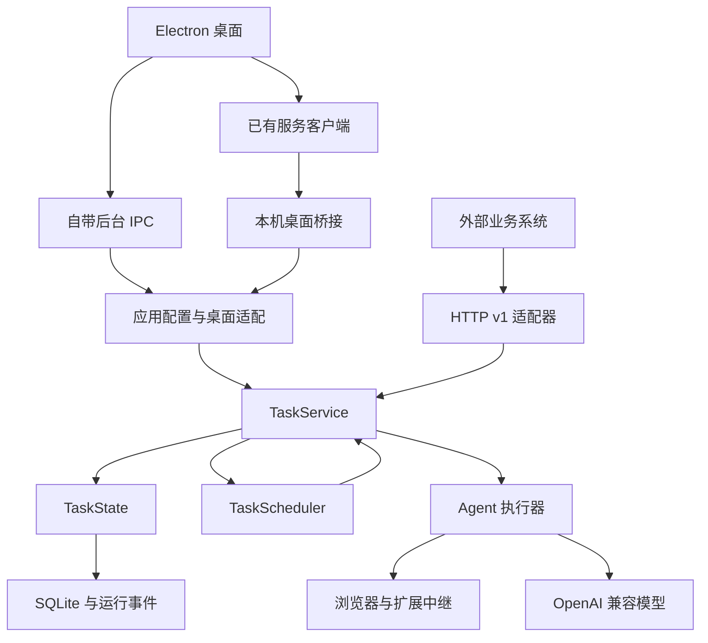

# 后台、任务和桌面的边界

[返回文档导航](README.md) · [开发与发布](development.md)

## 模块职责

- [runtime.js](../lib/runtime.js) 负责进程锁、监听端口和关闭顺序；只有服务所有者启动/关闭运行时。
- [application.js](../lib/application.js) 负责配置、订阅及桌面请求适配，不再独立实现任务开始、续聊、恢复、审批和控制规则。
- [http-api.js](../lib/http-api.js) 负责公开接口的鉴权、参数解析、幂等接收、资源输出及 HTTP/SSE 传输。
- [task-service.js](../lib/task-service.js) 负责会话占用、创建执行、恢复、续聊、暂停/取消、交互回复与执行启动。桌面和 HTTP 调用同一组方法。
- [task-state.js](../lib/task-state.js) 负责 Session/Run/Interaction 的持久化及事件投影。已结束的 Run 不再允许修改，revision 单调增加；读端不会按自己的规则修改状态。
- [task-scheduler.js](../lib/task-scheduler.js) 负责串行队列、闲置关闭、保留期限及任务取消；调度执行仍经由 TaskService。
- [agent.js](../lib/agent.js) 负责模型与工具循环，其本地运行状态是执行器的观测值。配置预检在取得 busy 槽位之前完成；初始化失败必须释放槽位，关闭失败保留浏览器引用供重试。
- [service-client.js](../lib/service-client.js) 负责本机服务连接、最新状态订阅和重连。客户端退出不会关闭远端服务，不重放历史命令。

## 状态与事务

Session 表示浏览器会话，Run 表示一次目标执行，Job 表示排队请求。完成一轮不等于关闭 Session；关闭已经完成的 Session 不会把其 completed Run 改写成 cancelled。

执行器继续使用原有内部状态名称以兼容检查点；统一映射定义在 [runs.js](../lib/runs.js)。持久化 Run 是 API 和桌面显示执行状态的共同依据。桌面将会话已关闭显示为停止，但历史 Run 的结果保持不变。

两个入口共用命令串行化队列。资源接收及状态事件写入同步 SQLite 事务；提交后才执行浏览器副作用，不跨 await 持有事务。HTTP 的幂等接收记录继续使用原表和作用域，因此升级不会失去旧请求的去重信息。

桌面恢复已有 Run 的检查点与 HTTP 保持一致：创建新的 Session 和 Run，保留原历史；恢复自身仍打开的闲置会话时先关闭它。更早、没有 Run 元数据的检查点保留专门兼容路径。

## 服务所有权

默认 Electron utility process 拥有运行时。设置 `OBU_SERVICE_URL` 后，该进程只充当客户端；不会打开服务数据库、申请锁或停止服务。两种方式复用相同 renderer 和 IPC 白名单。

独立服务断线重连使用完整状态快照，不补发命令；运行事件的可靠回放仍通过公开的每 Run SSE 接口提供。

当前保持单实例单浏览器、SQLite 和内存串行锁；这里没有引入多租户、跨实例调度或浏览器并发。若未来扩容，应先明确会话路由与浏览器资源归属，再调整这些约束。
